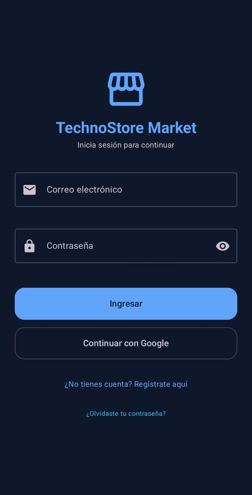
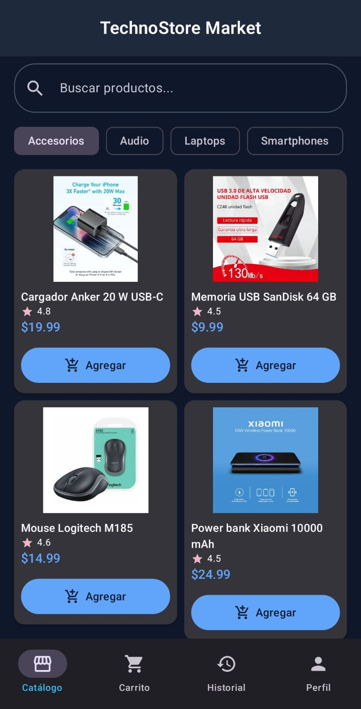
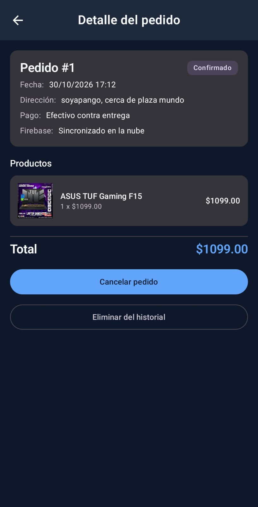
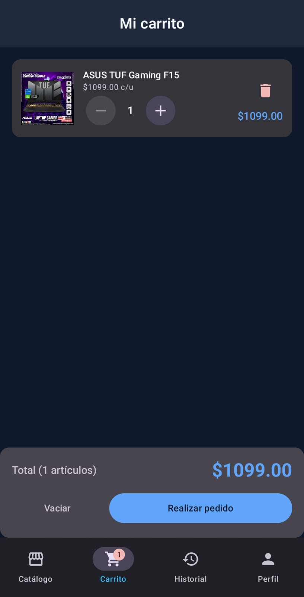
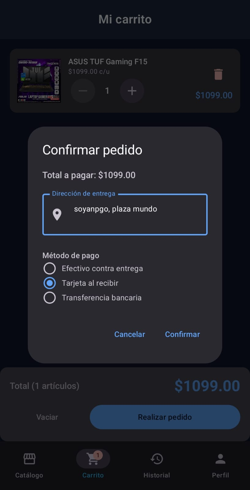
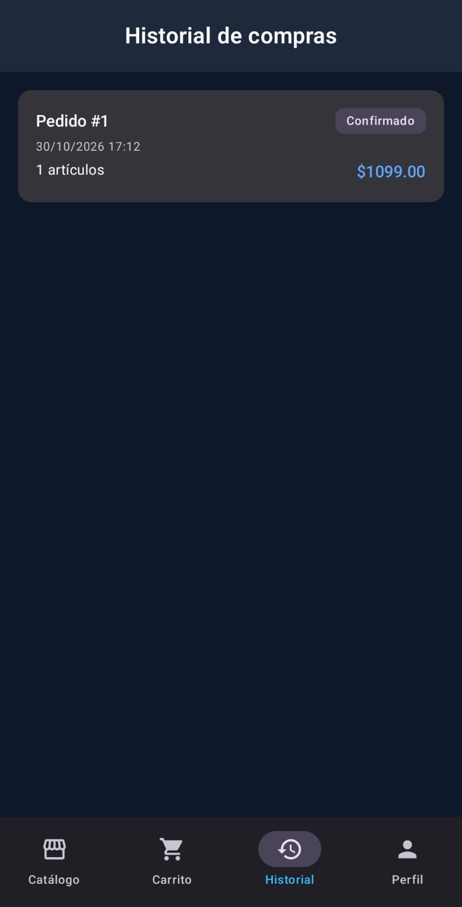
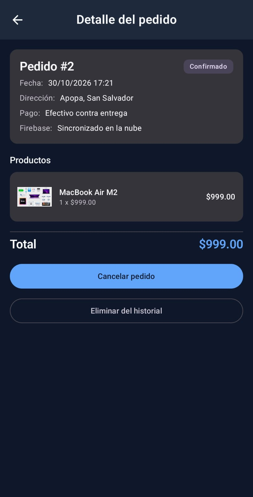
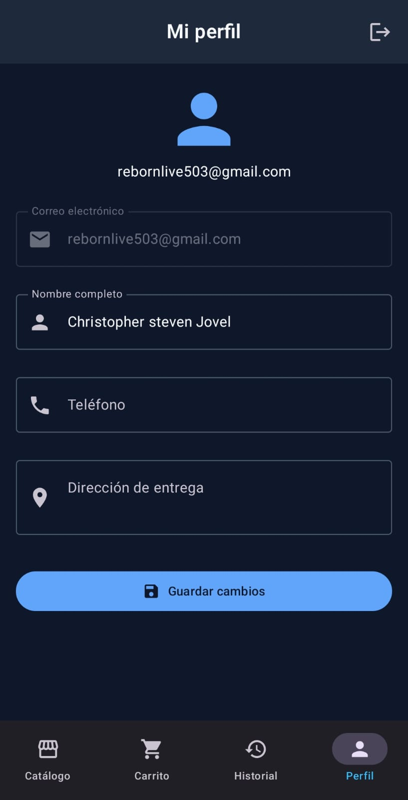

# 🛒 TechnoStore Market

Aplicación móvil Android para administrar los pedidos de una tienda de conveniencia.
Proyecto de Cátedra — **Desarrollo de Software para Móviles** (Universidad Don Bosco, Facultad de Ingeniería, Escuela de Computación).

## 📋 Descripción

TechnoStore Market permite a un cliente:

| Requerimiento del caso de estudio | Implementación |
|---|---|
| Registrarse e iniciar sesión | Firebase Authentication (correo/contraseña + Google) con validaciones y recuperación de contraseña |
| Consultar el catálogo | Colecciones `productos` y `categorias` de **Cloud Firestore**, con filtro por categoría |
| Buscar productos | Filtro por nombre/marca/descripción con *debounce* de 400 ms |
| Agregar productos al carrito | Subcolección `usuarios/{uid}/carrito` en Firestore (tiempo real), con control de stock |
| Registrar pedidos | Subcolección `usuarios/{uid}/pedidos`; el pedido se guarda y el carrito se vacía en un *batch* atómico |
| Consultar historial de compras | Lista de pedidos, detalle, cancelación y eliminación |
| Administrar su perfil | Documento `usuarios/{uid}` (nombre, teléfono, dirección), con validaciones |

## 👥 Integrantes

| Nombre | Carné |
|--|-|
| Guillermo Alejandro Espinoza Barahona | EB170303 |
| Christopher Steven Jovel Beltrán | JB251834 |
| Elisasbet Beatriz Marroquín Gonzalez | MG251360 |
| Edgardo Giovanni Cortez Valladares  | CV211195|

## 🧰 Tecnologías

- **Lenguaje:** Kotlin 2.2 · **UI:** Jetpack Compose + Material Design 3
- **Arquitectura:** MVVM + Repository Pattern + UI State (`StateFlow`)
- **Navegación:** Navigation Compose (`NavHost`, `NavController`, argumentos tipados)
- **Base de datos:** Cloud Firestore (listeners en tiempo real, *batch writes*, caché offline persistente)
- **Autenticación:** Firebase Authentication + Google Sign-In
- **Asincronía:** Corrutinas (`suspend`, `viewModelScope.launch`, `Dispatchers.IO`) y `Flow`
- **Imágenes:** Coil

## 🏗️ Arquitectura

```
┌─────────────────────────────── UI (Jetpack Compose) ───────────────────────────────┐
│  Screens ──► observan UiState (StateFlow) ──► Componentes reutilizables (M3)       │
└───────────────▲──────────────────────────────────────────┬─────────────────────────┘
                │ StateFlow<UiState>                       │ eventos (onClick, etc.)
┌───────────────┴──────────────────────────────────────────▼─────────────────────────┐
│  ViewModel  (MutableStateFlow privado → StateFlow público, viewModelScope.launch)  │
└───────────────▲────────────────────────────────────────────────────────────────────┘
                │ Result<T> / Flow<T>
┌───────────────┴────────────────────────────────────────────────────────────────────┐
│  Repository  (withContext(Dispatchers.IO), manejo de excepciones → Result)         │
└───────▲───────────────────▲──────────────────────────▲─────────────────────────────┘
        │                   │                          │
        Firebase Authentication          Cloud Firestore
```

**Flujo de datos unidireccional:** la UI solo lee `UiState` y envía eventos al ViewModel; el ViewModel
nunca conoce a Compose; el Repository nunca conoce al ViewModel. Las dependencias se inyectan con un
contenedor manual (`AppContainer`) y una `AppViewModelFactory`.

### Estructura del proyecto

```
app/src/main/java/edu/udb/technostore_market/
├── MainActivity.kt                # Punto de entrada (Compose)
├── TechnoStoreApp.kt              # Application: crea el AppContainer
├── di/AppContainer.kt             # Inyección de dependencias manual
├── model/                         # Modelos de dominio (Producto, ItemCarrito, Pedido, PerfilUsuario)
├── data/
│   ├── firebase/                  # Acceso a Firestore
│   │   ├── FirestoreRutas.kt      # Nombres de colecciones y campos
│   │   ├── FirestoreMappers.kt    # Documento <-> modelo de dominio
│   │   ├── FirestoreFlows.kt      # addSnapshotListener -> Flow (tiempo real)
│   │   └── CatalogoInicial.kt     # Datos semilla del catálogo (se suben una vez)
│   └── repository/                # Auth, Producto, Carrito, Pedido, Perfil, SessionManager
├── viewmodel/                     # Un ViewModel + UiState por pantalla
├── util/                          # Validadores, manejo de errores, formatos
└── ui/
    ├── TechnoStoreRoot.kt         # Scaffold + TopAppBar + BottomNavigation + Snackbar
    ├── navigation/                # Rutas y NavHost
    ├── components/                # CampoTexto, ProductoCard, ItemCarritoCard, Dialogos, Estados...
    ├── auth/ catalogo/ detalle/ carrito/ pedidos/ perfil/   # Pantallas
    └── theme/                     # Tema Material 3 (claro/oscuro)
```

## 📱 Pantallas y componentes obligatorios

| Requisito | Dónde se usa |
|---|---|
| `Scaffold` | `ui/TechnoStoreRoot.kt` |
| `TopAppBar` | `CenterAlignedTopAppBar` en `TechnoStoreRoot.kt` (título dinámico, botón atrás, cerrar sesión) |
| `BottomNavigation` | `NavigationBar` (M3) con insignia del carrito en `TechnoStoreRoot.kt` |
| `LazyColumn` | Carrito, historial, detalle de pedido (`LazyRow` para categorías y `LazyVerticalGrid` en el catálogo) |
| `Card` | `ProductoCard`, `ItemCarritoCard`, tarjetas de pedido y resumen del carrito |
| `Dialog` | `DialogoConfirmacion` (quitar, vaciar, cancelar, eliminar, salir) y `DialogoPedido` (dirección + método de pago) |
| `Snackbar` | `SnackbarHost` global + `EfectoMensaje` (mensajes de un solo uso desde el ViewModel) |
| Argumentos entre pantallas | `producto/{productoId}` (Int) y `pedido/{pedidoId}` (Long), leídos con `SavedStateHandle` |

## 🔥 Modelo de datos en Cloud Firestore

| Colección | Documento | Campos |
|---|---|---|
| `categorias` | `{idCategoria}` | idCategoria, nombre |
| `productos` | `{idProducto}` | idProducto, nombre, descripcion, precio, stock, idCategoria, imagenUrl, marca, calificacion |
| `usuarios` | `{uid}` | uid, nombre, email, telefono, direccion, fechaRegistro |
| `usuarios/{uid}/carrito` | `{idProducto}` | idItemCarrito, idProducto, nombreProducto, precioUnitario, cantidad, imagenUrl, stock |
| `usuarios/{uid}/pedidos` | `{idPedido}` | idPedido, idUsuario, fecha, estado, total, direccion, metodoPago, items[] |

- **Tiempo real:** carrito, historial y perfil se observan con `addSnapshotListener` convertido a `Flow` (`FirestoreFlows.kt`).
- **Offline (RNF04):** caché persistente de Firestore activada en `AppContainer`; un pedido creado sin red se muestra como «Pendiente de sincronizar» hasta que se sube.
- **Catálogo inicial:** si la colección `productos` está vacía, la app sube `CatalogoInicial` una sola vez. Las imágenes se agregan pegando la URL en el campo `imagenUrl` desde la consola.
- **Seguridad:** reglas en `firestore.rules` (cada usuario solo accede a su propio documento y subcolecciones).
- Los errores se capturan en el repositorio (`llamadaSegura`) y se traducen a mensajes legibles (`toUserMessage`).

## ✅ Validaciones

- **Registro:** nombre obligatorio (≥ 3), correo con formato válido, contraseña ≥ 6, confirmación idéntica.
- **Login:** correo válido y contraseña obligatoria; errores de Firebase traducidos (credenciales incorrectas, cuenta inexistente, sin conexión…).
- **Perfil:** nombre, teléfono de 8 dígitos y dirección (≥ 10 caracteres) obligatorios, con mensaje bajo cada campo.
- **Pedido:** dirección obligatoria y carrito no vacío; el stock limita la cantidad de cada producto.
- Las reglas viven en `util/Validadores.kt` (funciones puras) y tienen pruebas unitarias.

## ⚙️ Instalación

### Requisitos
- Android Studio (versión reciente compatible con **AGP 9.x**) y JDK 17+ (el proyecto usa el JDK de Android Studio)
- Dispositivo o emulador con **Android 10 (API 29) o superior** y servicios de Google Play
- Conexión a Internet (Firebase)

### Pasos
1. Clona el repositorio:
   ```bash
   git clone https://github.com/Chris103105/TechnoStore_Market.git
   ```
2. Ábrelo con **Android Studio** y espera a que Gradle sincronice.
3. El archivo `app/google-services.json` ya está incluido (proyecto Firebase `technostoremarket-3ec5e`).
   Para usar **Google Sign-In** el SHA-1 de la llave de depuración del equipo debe estar registrado en Firebase;
   el repositorio incluye `app/debug.keystore` compartida para ese fin.
4. En la consola de Firebase, habilita los proveedores **Correo/contraseña** y **Google** en *Authentication → Sign-in method*.
5. Crea la base de datos en *Firestore Database → Crear base de datos* y pega el contenido de `firestore.rules` en la pestaña **Reglas** → *Publicar*.
6. Ejecuta la app (`Run ▶`) en un emulador o dispositivo.

### Ejecutar pruebas
```bash
./gradlew test
```

## 📦 Dependencias principales

| Librería | Uso |
|---|---|
| Compose BOM + Material 3 + Material Icons Extended | Interfaz |
| Navigation Compose 2.9.x | Navegación |
| Lifecycle ViewModel / Runtime Compose 2.11 | MVVM y `collectAsStateWithLifecycle` |
| Kotlinx Coroutines (+ Play Services) | Corrutinas y `await()` de Firebase |
| Firebase Auth + Cloud Firestore (BoM) + Play Services Auth | Autenticación y base de datos |
| Coil Compose | Carga de imágenes |

Las versiones están centralizadas en `gradle/libs.versions.toml`.

## 🖼️ Capturas de pantalla

> LAS CAPTURAS IRAN AQUI.

| Login | Catálogo | Detalle |
|---|---|---|
|  |  |  |

| Carrito | Confirmar pedido | Historial |
|---|---|---|
|  |  |  |

| Detalle de pedido | Perfil |
|---|---|
|  |  |

## 🧪 Calidad de código

- Separación en capas (UI / ViewModel / Repository / fuentes de datos) y un modelo de dominio independiente de Firestore.
- Componentes Compose reutilizables (`CampoTexto`, `ProductoCard`, `ItemCarritoCard`, `DialogoConfirmacion`, `EstadoCargando/Error/Vacio`, `SelectorCantidad`, `EfectoMensaje`).
- Nombres descriptivos, `Result<T>` para errores esperados y cancelación de corrutinas respetada.
- Pruebas unitarias de validaciones y formatos (`app/src/test`).
